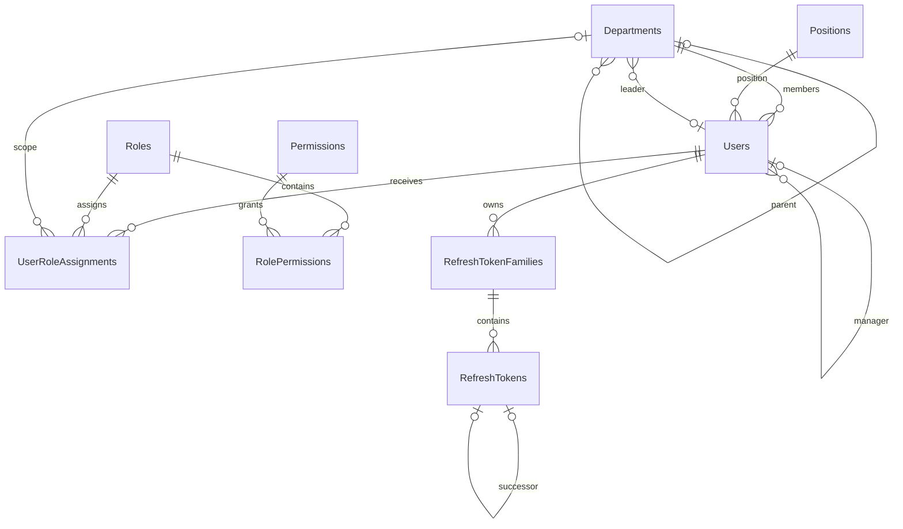

# C1-01 Design Specification — v1.0

Ngày 05/11/2026. Căn cứ ONEOFFICE-C1-APPROVAL-001 trong APPROVAL_RECORD.md.
Các quyết định Owner được ghi Approved. Chi tiết kỹ thuật dưới đây là phương án triển khai theo ủy quyền, có thể review. Retention audit còn Pending, không bật tự động xóa.

## Kiến trúc và ownership
.NET 10, EF Core 10, PostgreSQL 18, React/TypeScript/Vite/Tailwind/shadcn. Single-company Clean Modular Monolith.
API → Core và Infrastructure. Infrastructure → Core. Core không phụ thuộc EF/HTTP hoặc hai project còn lại. Solution ở root.
Core/SharedKernel chỉ chứa primitive dùng chung. Core/Modules/{Identity,Organization,AccessControl}/{Domain,Application} chứa domain, use case và ports.
Identity sở hữu Users và sessions. Organization sở hữu Departments/Positions và kiểm tra membership/reporting/leader. AccessControl sở hữu role/grants. Infrastructure triển khai persistence, token, hashing và durable audit. API sở hữu HTTP DTO/composition.
Một DbContext, cross-module use case qua interface và cùng transaction khi cần atomicity.

## ERD

AuditLogs lưu snapshot actor/target, không FK để giữ chứng cứ độc lập vòng đời entity.

## Data dictionary
Dấu ? là nullable; cột khác NOT NULL. UUID do app tạo. CreatedAt/UpdatedAt là timestamptz default CURRENT_TIMESTAMP, app cập nhật UpdatedAt. Version bigint default 1, tăng mỗi lần sửa. Code trim uppercase; permission lowercase. Mọi FK NO ACTION. Mọi FK có index. Không hard delete nghiệp vụ.

| Bảng | Cột |
|---|---|
| Departments | Id uuid PK; Code varchar(30) unique; Name varchar(200); ParentId uuid? FK self; LeaderId uuid? FK Users (index KHÔNG unique); Description varchar(2000)?; SortOrder int default 0; IsActive bool default true; CreatedAt; UpdatedAt; Version |
| Positions | Id uuid PK; Code varchar(30) unique; Name varchar(200); Level int default 0; Description varchar(2000)?; IsActive bool default true; CreatedAt; UpdatedAt; Version |
| Users | Id uuid PK; EmployeeCode varchar(30) unique; FullName varchar(200); Email varchar(255); PasswordHash text; DepartmentId uuid FK; PositionId uuid FK; DirectManagerId uuid? FK self; ManagerExempt bool default false; ManagerExemptionReason varchar(500)?; PhoneNumber varchar(30)?; AvatarUrl varchar(2048)?; IsActive bool default true; MustChangePassword bool default true; AuthorizationVersion bigint default 1; LastLoginAt timestamptz?; CreatedAt; UpdatedAt; Version |
| Roles | Id uuid PK; Code varchar(100) unique; Name varchar(160); Description varchar(1000)?; IsSystem bool default true |
| Permissions | Id uuid PK; Code varchar(160) unique; Description varchar(1000) |
| RolePermissions | RoleId uuid FK; PermissionId uuid FK; composite PK(RoleId,PermissionId) |
| UserRoleAssignments | Id uuid PK; UserId uuid FK; RoleId uuid FK; ScopeType varchar(20); ScopeDepartmentId uuid? FK; GrantedByUserId uuid? FK; CreatedAt |
| RefreshTokenFamilies | Id uuid PK; UserId uuid FK; CreatedAt; AbsoluteExpiresAt timestamptz; RevokedAt timestamptz?; RevocationReason varchar(50)? |
| RefreshTokens | Id uuid PK; FamilyId uuid FK; TokenHash varchar(64) unique; CreatedAt; ExpiresAt timestamptz; ConsumedAt timestamptz?; RevokedAt timestamptz?; ReplacedByTokenId uuid? |
| AuditLogs | Id uuid PK; OccurredAt timestamptz; ActorUserId uuid?; ActorKind varchar(20); Action varchar(160); TargetType varchar(80)?; TargetId uuid?; Outcome varchar(20); ReasonCode varchar(100)?; CorrelationId varchar(100); Changes jsonb default '{}'; Metadata jsonb default '{}' |

Unique lower(Email). Check Department.ParentId != Id; User.DirectManagerId != Id; SortOrder/Level >= 0; Version/AuthorizationVersion > 0.
ManagerExempt=true yêu cầu reason không trắng; false yêu cầu reason NULL. User có manager NULL phải có ManagerExempt=true. Chỉ SuperAdmin sửa exemption qua endpoint riêng; grant/revoke ghi actor, thời điểm và thay đổi trong AuditLogs cùng transaction. Bootstrap/recovery dùng ActorKind=System/Recovery và lý do bắt buộc. Thu hồi exemption khi manager NULL bị từ chối hoặc phải gán manager cùng transaction. Exemption không tự cấp quyền, không tự suy ra từ chức danh.
Unique assignment (UserId,RoleId,ScopeType,ScopeDepartmentId) NULLS NOT DISTINCT. Department/DepartmentTree cần ScopeDepartmentId; All/Self cần NULL. Role/scope compatibility kiểm tra application.
Token unique (FamilyId,Id); FK (FamilyId,ReplacedByTokenId) → (FamilyId,Id), unique ReplacedByTokenId; check successor != Id. Partial unique FamilyId WHERE ConsumedAt IS NULL AND RevokedAt IS NULL. Expiry token <= family expiry kiểm tra transaction. Index family(UserId), family(AbsoluteExpiresAt), token(ExpiresAt), Users(DepartmentId,IsActive).
Audit indexes (OccurredAt,Id), (ActorUserId,OccurredAt), (TargetType,TargetId,OccurredAt), (Action,OccurredAt). Không GIN mặc định.

## Organization và concurrency
Nhiều root. User bắt buộc department/position. Leader active có thể lãnh đạo nhiều phòng, khác phòng membership. DirectManager active, khác self, không cycle. Leader và manager cập nhật độc lập, không tạo grants.
Chuyển phòng dùng managerSelection keep/assign/clear. keep kiểm tra manager hiện tại; clear cần exemption. Không tự thay leader/direct reports/grants.
Disable department chặn active child/member, leader chưa gỡ, scope grant chưa xử lý. Disable position chặn active employee. Disable user chặn active reports, leader assignment và SuperAdmin active cuối cùng. Reactivate kiểm tra active dependencies. Codes/email không tái sử dụng sau disable.
Thứ tự khóa thống nhất: transaction advisory lock OrgGraph → PrivilegedAccounts → Users theo UUID tăng dần → Families theo UUID tăng dần → Tokens. Mọi write org, membership, manager, leader, exemption, status, grant lấy OrgGraph rồi PrivilegedAccounts khi có thể ảnh hưởng privileged invariant. Auth chỉ lấy Users rồi Families/Tokens, tuyệt đối không lấy khóa phía trước sau đó. Đọc lại và kiểm tra sau khóa; optimistic Version bảo vệ stale update. Audit insert cùng transaction. Không network I/O trong transaction. Deadlock/serialization retry bounded, chỉ retry transaction chưa commit, kiểm tra lại quyền/invariant.
Tree query tính descendant từ database hiện hành, scope/filter/count cùng statement hoặc snapshot. Sau reparent commit quyền thay đổi ở query kế tiếp; không cache subtree trong JWT. Tree giới hạn root scope, không lộ ancestor/sibling ngoài scope.

## Permission catalog và role mapping
Mỗi action phân cách bằng dấu / dưới đây là permission riêng. Assignment permission và scope luôn đi cùng nhau; union theo cùng permission. Quyền trên field và privileged target áp dụng sau union.

| Role / scope được gán | Permissions |
|---|---|
| SuperAdmin / All | tất cả permission trong catalog |
| HRAdmin / All | organization.department.read/create/update/status; organization.position.read/create/update/status; identity.user.read/create/update/status; access.role.read; access.permission.read; access.role.assignment.read/replace |
| DepartmentManager / Department hoặc DepartmentTree | identity.user.read; organization.department.read; organization.position.read |
| Employee / Self | identity.user.read; identity.profile.read/update; identity.password.change; organization.department.read; organization.position.read |

Catalog thêm identity.manager-exemption.update và audit.log.read, chỉ SuperAdmin. Self-only profile/password endpoint luôn kiểm tra target=caller kể cả role All. Mọi user seed Employee/Self, role thêm là grant riêng. SuperAdmin có audit All. Chỉ SuperAdmin quản lý HRAdmin/SuperAdmin, kể cả sửa field/status/grants. HRAdmin chỉ quản trị tài khoản thường và gán Employee/Self hoặc DepartmentManager với scope cụ thể; không sửa grants của mình. Khóa và kiểm tra target roles hiện hành trong transaction. Không xóa SuperAdmin active cuối cùng.
Metadata least privilege: All xem mọi department/position; Department/Tree chỉ department trong scope và positions được dùng bởi nhân sự trong scope; Self chỉ department/position của caller. Không cấp metadata All ngầm. Summary leader/manager chỉ có id/name nếu caller có identity.user.read trên user đó, nếu không trả null.
Directory projection chỉ id, employeeCode, fullName, department, position, permitted manager, isActive. Admin/self được email theo quyền. Phone/avatar chỉ self profile; HRAdmin sửa business fields của tài khoản thường, không sửa private profile qua user DTO. PasswordHash/token hash/secret không xuất hiện ở DTO/audit/log. Search email chỉ khi projection được phép email. Filter và count không mở rộng scope.

## Authentication, bootstrap và recovery
JWT 15 phút; family tuyệt đối 7 ngày từ login. Random refresh >=256 bit, SHA-256 hex, chỉ hash được lưu. Cookie HttpOnly/Secure/SameSite=Lax/Path=/api/v1/auth, host-only. SPA same origin, access token in-memory. Origin allowlist chính xác, CSRF header + antiforgery cookie cho login/refresh/logout. GET csrf trả token và Cache-Control no-store. Auth response no-store. Rate limit login theo IP và tài khoản, refresh theo IP/session, cấu hình giới hạn phải được kiểm thử trước staging.
Login kiểm tra active, tạo family/token và audit cùng transaction. JWT chứa sub,sid,jti,issuer,audience,expiry,authorizationVersion. Request kiểm tra user active, version, family hiệu lực. Grants thay đổi tăng version; refresh cấp JWT với grants hiện hành. Department scope truy vấn động.
Refresh khóa user/family, đọc lại token. Token chưa dùng và hợp lệ: consume rồi tạo successor cùng transaction, giữ expiry tuyệt đối, commit trước response. Replay token consumed: revoke family + audit rồi COMMIT trước trả 401; không rollback revocation bằng exception handler. Không grace window hoặc trả lại successor. Hai refresh đồng thời có thể một 200 rồi family bị revoke; access token cũng bị từ chối. Mất response dẫn đến đăng nhập lại khi retry token cũ. Frontend phối hợp lock giữa tab + broadcast kết quả, không lưu refresh secret trong JS.
Logout revoke family; disable/password change/recovery revoke mọi family. Login/refresh/disable lấy user lock để không tạo session sau disable. Audit thất bại ở mutation làm rollback. Login thất bại ghi security audit transaction riêng, không lưu email/password đầu vào tùy ý; metadata allowlist và giới hạn độ dài, bảo vệ chống log flooding.
Bootstrap local maintenance command, secret qua stdin ẩn hoặc secret provider, không command-line/history/repo. Khóa bootstrap, tạo department/position rồi SuperAdmin có exemption và reason, grants + audit trong transaction. Chạy lại từ chối tạo trùng, không reset mật khẩu ngầm.
Recovery chỉ operator có OS/DB maintenance credential và yêu cầu Owner được ghi nhận; không public endpoint. Tạm dừng app writes, backup, xác minh operator qua kênh quản trị, chạy maintenance command với target user ID, reason và password nhập kín. Khóa OrgGraph/PrivilegedAccounts/user; xác minh department/position active và dependencies, reset hash, activate hợp lệ, cấp SuperAdmin nếu cần, tăng version, revoke sessions, ghi audit Recovery cùng transaction. Không xóa grant người khác. Kiểm tra login/bắt đổi password, thu hồi recovery secret, kết thúc maintenance. Runtime DB role không có quyền sửa/xóa audit; maintenance role riêng được quản lý bởi operator. Secrets local dùng user-secrets, staging secret store/env bảo vệ ACL; JWT signing key versioned/rotatable, không đưa vào source.

## Durable audit và retention
Audit ghi create/update/status, leader/manager/exemption/grant changes, bootstrap/recovery, login success/failure, rotation/replay/revocation/password change. Mutation và audit cùng transaction; failed attempt không có mutation ghi transaction riêng. Changes chỉ field allowlist với before/after đã redacted, IDs tổ chức/grants/status/version; email/phone và mật khẩu không ghi raw. Không serialize request hoặc entity. ActorKind User/System/Recovery/Anonymous; Outcome Success/Denied/Failure. CorrelationId nối structured logs; IP/device chỉ thêm sau privacy review.
Runtime INSERT audit, SuperAdmin API đọc bằng read-only query; không API update/delete. Đọc audit cũng ghi event truy cập, không đưa nội dung audit vào audit mới. Query pagination/date range tối đa 31 ngày/request. Audit read failure không trả dữ liệu.
Retention PROPOSED 365 ngày online; Owner chưa duyệt. Không automatic purge trước phê duyệt. Trước staging chốt retention/archive/backup/legal hold và capacity. Schema không phụ thuộc số ngày; purge sau này bằng maintenance role, audit riêng, không cascade.

## API contract
Prefix /api/v1. UUID string, UTC ISO-8601, camelCase. GET detail ngoài scope=404. Fields lạ=400. PUT yêu cầu mọi field cho phép, nullable phải gửi rõ. Status/PUT nhận Version, stale=409. Create 201+Location, update/list/detail 200, logout/password change 204.

| Route | Request → Response / permission |
|---|---|
| GET /auth/csrf; POST /auth/login | csrf; {email,password} → AuthResponse / anonymous có Origin/CSRF |
| POST /auth/refresh; POST /auth/logout | cookie+CSRF → AuthResponse / 204 |
| GET /auth/me | → id,name,email,organization,assignments,effectiveGrants,mustChangePassword / authenticated |
| GET/PUT /profile | {phoneNumber?,avatarUrl?,version} → self profile / identity.profile.read/update |
| POST /profile/change-password | {currentPassword,newPassword} → 204 / identity.password.change |
| GET /departments/tree | → [{id,code,name,leader?,children}] / organization.department.read |
| GET/POST /departments; GET/PUT /departments/{id} | {code,name,parentId?,leaderId?,description?,sortOrder,version(for PUT)} → department DTO / corresponding read/create/update |
| PATCH /departments/{id}/status | {isActive,version} → department / department.status |
| GET/POST /positions; GET/PUT /positions/{id} | {code,name,level,description?,version(for PUT)} → position DTO / corresponding permission |
| PATCH /positions/{id}/status | {isActive,version} → position / position.status |
| GET/POST /users; GET/PUT /users/{id} | create {employeeCode,fullName,email,departmentId,positionId,directManagerId?,initialPassword,managerExemption?(SuperAdmin only)}; update same business fields with managerSelection and version, without password → scoped user projection / identity.user.read/create/update |
| PATCH /users/{id}/status | {isActive,version} → user / identity.user.status |
| PUT /users/{id}/manager-exemption | {enabled,reason?,managerSelection,version} → user exemption + version / identity.manager-exemption.update |
| GET /roles; GET /permissions | → catalog arrays / access.role.read, access.permission.read |
| GET/PUT /users/{id}/roles | {authorizationVersion,assignments:[{roleCode,scopeType,scopeDepartmentId?}]} → assignments+version / access.role.assignment.read/replace |
| GET /dashboard/summary | counts per corresponding read permission, absent permission gives null / authenticated |
| GET /audit-logs | date range, actorId?,targetId?,action?,outcome?,page,pageSize → safe audit projection / audit.log.read |

ManagerSelection {mode:keep}, {mode:assign,managerId} hoặc {mode:clear}; clear cần exemption. Create với null manager yêu cầu exemption do SuperAdmin cấp atomically; HRAdmin không được gửi exemption. AuthResponse chỉ accessToken,tokenType,expiresIn=900,mustChangePassword; refresh cookie. MustChangePassword chỉ cho me/password/logout trước khi đổi.
Department/position responses gồm id, fields, isActive, timestamps, version. Role response gồm code,name,allowedScopeTypes,permissions. User detail riêng admin/self/directory, không serialize entity. Audit response gồm dictionary fields đã sanitized, không secret.
Validation code 1–30 [A-Z0-9_-], name 1–200, email hợp lệ <=255 case-insensitive unique, reason 1–500, level/sortOrder >=0. Password 12–128, không trim, chấp nhận passphrase. Phone <=30; avatar HTTPS, backend không fetch URL. Active user chỉ dùng active department/position/manager.
Lists {items,page,pageSize,totalCount}; page>=1, size default20/max100. search<=100. Users filters departmentId/includeDescendants/positionId/isActive; departments parentId/isActive; positions isActive. sort allowlist users employeeCode/fullName/createdAt, departments sortOrder/name/code, positions level/name/code, audit occurredAt; asc/desc + id tie-breaker. Scope trước filters/count. includeInactive chỉ admin trong scope.
Errors ProblemDetails {type,title,status,code,traceId,errors?}, không stack hoặc tên dependency ngoài quyền. 400 validation.failed/request.invalid; 401 auth.invalid_credentials/auth.session_invalid/auth.refresh_reused; 403 access.denied/access.field_denied/auth.csrf_invalid/auth.password_change_required; 404 resource.not_found; 409 concurrency.conflict/resource.duplicate_code/user.email_conflict/organization.department_cycle/organization.manager_cycle/organization.assignment_inactive/organization.active_dependencies/organization.manager_required/access.last_superadmin; 429 rate_limit.exceeded + Retry-After; 500 server.unexpected. Không còn leader_department_mismatch.

Example PUT /users/{id}: {"employeeCode":"NV08","fullName":"Nguyễn An","email":"an@example.com","departmentId":"8f2e8c6d-31f3-45db-8ff0-1455b584a9bf","positionId":"2a7d0c2f-7f75-4c20-b270-c04414d85540","managerSelection":{"mode":"keep"},"version":3}. Response 200 user projection version4. Cycle trả {"type":"urn:oneoffice:problem:organization.manager_cycle","title":"Quan hệ quản lý tạo chu trình","status":409,"code":"organization.manager_cycle","traceId":"request-id"}.

## Acceptance scenarios (thiết kế; chưa chạy)
- Leader hai phòng khác membership thành công, không unique conflict; inactive leader bị chặn; không tạo RBAC.
- Manager khác phòng thành công, self/multilevel cycle bị chặn. Hai transactions A→B/B→A không cùng commit.
- Department reparent cycle và concurrent opposing moves bị chặn; query sau reparent phản ánh scope mới cả detail/count.
- Exemption chỉ SuperAdmin; grant/revoke atomic audit; null manager không exemption bị DB check chặn; bootstrap có exemption hợp lệ.
- HRAdmin self-elevation hoặc quản trị privileged target bị 403; permission role A không dùng scope role B; DTO/search/count không leak email.
- Hai SuperAdmin đồng thời revoke/disable nhau vẫn còn một active admin. Assign leader đồng thời disable user giữ invariant.
- Disable có active dependencies/grants bị chặn; stale Version=409; duplicate email case-insensitive=409.
- Rotation, replay, mất response và nhiều tab; revoke phải persist dù trả 401; family 7 ngày không gia hạn; revoke/password/disable race không tạo session còn dùng được.
- Origin/CSRF thiếu hoặc sai bị từ chối; token/password không xuất hiện ở logs/audit; brute force bị rate limit.
- Audit insert failure rollback mutation; user thường đọc audit=403; runtime update/delete audit bị DB từ chối.
- Recovery yêu cầu maintenance credential, không HTTP public; revoke mọi session, ghi actor/reason và bắt đổi password; rollback khi audit lỗi.
- PostgreSQL thật kiểm chứng FK, unique NULL, advisory lock/concurrency. UI E2E widths375/768/1280 và keyboard/focus.

## Closeout
B01–B05 có phương án kỹ thuật cụ thể. Approval record lưu chỉ thị nguyên văn. Pending retention 365 ngày, domains/secrets vận hành, thương hiệu, lịch backup trước staging; không tự phê duyệt giá trị. Schema/security của C1-01 có contract để triển khai. C1-02 chỉ scaffold/build. C1-03 chờ giao riêng.
