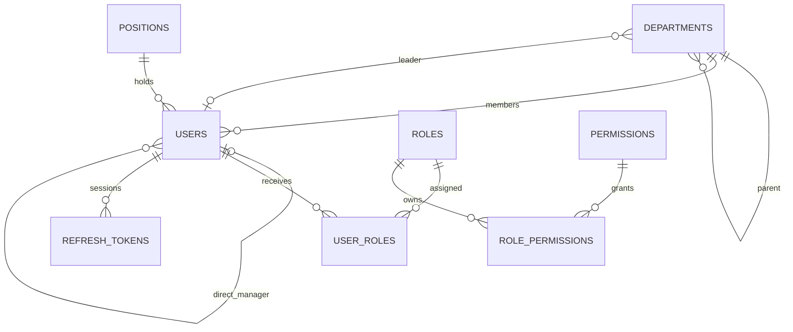

# ONEOFFICE CORE — MASTER EXECUTION PLAN & AI AGENT HANDOFF

**Document ID:** OOC-MASTER-001  
**Version:** 1.0.0 | **Status:** Approved planning baseline (not software acceptance)  
**Prepared:** 2026-11-04 (Asia/Ho_Chi_Minh)  
**Project:** OneOffice Core — phần lõi quản trị doanh nghiệp nội bộ  
**Owner:** Solo developer | **Capacity:** 15–20 h/week | **UI priority:** polished from the beginning  
**Primary reference:** `Tai-Lieu-Kien-Truc-Ke-Hoach-Va-Bo-Prompt-OneOffice.pdf` (6 pages, version 1.0.0)

> **READ THIS FIRST — INSTRUCTIONS FOR EVERY AI AGENT**
> 1. Read this complete file, `PROJECT_STATE.md`, `DECISIONS.md`, and `TASKS.md` before proposing code or changes.
> 2. Never claim work is complete until there is a verifiable changed file, command output, and test result.
> 3. Work on one ticket at a time in dependency order. Give exact paths, complete code (no TODO in critical logic), commands to run, tests, risks, and updated state.
> 4. Do not silently alter the tech stack, domain rules, database constraints, API contracts, security decisions, scope, schedule, or architecture. Propose an ADR first.
> 5. A message in another AI conversation is **not automatically shared**. The repo files and pasted handoff are the only authoritative synchronization channel. Ask for the latest `PROJECT_STATE.md` when stale.
> 6. Do not overwrite modifications made by the other agent or by the developer. Verify `git status` and current file contents before editing.
> 7. Treat PDF as source design, this document as agreed implementation plan, source code/tests as evidence of actual implementation. If these disagree, call out the conflict rather than improvising.

---

## A. SOURCE TRACEABILITY & BOUNDARIES

### A1. Directly grounded in source PDF
- p.1: Clean Modular Monolith, C#/.NET, PostgreSQL JSONB + GIN, React / Next.js + Tailwind + shadcn/ui, sequential/conditional workflow.
- p.2: Core groups: `Departments`, `Positions`, `Users` with `DirectManagerId`; `FormDefinitions`/`FormSubmissions`; workflow definitions/instances/tasks. Original broad schedule: 11 weeks across six phases, **assuming a different unspecified effort level**.
- p.3: Clean Architecture layers, EF Core + Npgsql, FluentValidation, optional MediatR, MiniExcel/QuestPDF; solo-dev requirement, avoid overengineering.
- p.4: Phase 1: parent-child departments; each user in one department, one position, direct manager; department leader; JWT + refresh; Fluent API avoid cascades; demo 3-level org tree; `GET` tree endpoint.
- p.4–6: Later phases dynamic form with schema/JSONB, sequential conditional workflow, UI renderer/inbox, JSONB reports/export. **These are NOT Phase 1 deliverables.**

### A2. Project decisions/extensions (not statements from PDF)
- Single company, no Tenants/TenantId, no SaaS billing.
- 15–20 h/week, professional UI from start; **Phase 1 = six weeks / 105 budget hours**, rather than original two weeks.
- .NET 10 LTS + EF Core 10 + compatible Npgsql provider; .NET 8/9 support ends 2026-11-10. Verify versions when installing. PostgreSQL 16, React + TypeScript + Vite, React Router, Tailwind, shadcn/ui, react-hook-form, Zod, TanStack Query. NPM versions should be locked via lockfile when installed.
- Modularity by feature: `Identity`, `Organization`, `AccessControl`, shared infrastructure; one backend deployable and one PostgreSQL instance. API prefix `/api/v1`.
- RBAC with roles and permissions plus record scopes; authenticated API checks are authoritative.
- Prefer adjacency list (`Department.ParentId`) + recursive CTE; do not add materialized path unless profiling justifies.
- No workflow/BPMN, Redis, message broker, or microservice in Phase 1.
- See `DECISIONS.md` for conventions and unsettled rules.

### A3. Scope and objective
**Phase 1 goal:** polished internal web app allowing login/logout, personnel/positions/departments management, 3-level department tree, manager/department leader assignment, roles, permissions, profile/dashboard, robust testing, and staging deployment. The system must provide stable user/org information for Phase 2 Dynamic Forms and Phase 3 Approvals.

**Out of scope:** Form Builder, JSONB submission, approval execution, report export, payroll, attendance, leaves, SSO, file storage, drag-and-drop org chart, production HA, multi-tenant architecture.

## B. ARCHITECTURE — FINAL BASELINE

```text
Browser (React SPA, Vite, TypeScript)
  -> HTTPS / same-origin reverse proxy
ASP.NET Core 10 API (/api/v1)
  -> Identity module (auth, user and session)
  -> Organization module (department tree, position, manager, leader)
  -> AccessControl module (roles, permissions, record scopes)
  -> Shared Infrastructure (PostgreSQL/EF Core, logging, validation, exceptions)
PostgreSQL 16
```

**Backend boundaries:** `Api` (HTTP composition), `SharedKernel` (small stable shared types), `Infrastructure` (DbContext/provider, migrations, hashing, token implementation), `Modules/*` (domain/application). Keep domain free of EF/HTTP details; applications use interfaces for cross-module lookups. Starting as folders in a single project is allowed to reduce solo-dev overhead, but folders/namespaces must respect module boundaries. Architecture tests later protect boundaries.

**Frontend boundaries:** `app/` (router/providers/layout), `features/auth`, `features/dashboard`, `features/employees`, `features/departments`, `features/positions`, `features/access-control`; `components/ui` for reusable primitives; `lib/api` for typed client. Use server pagination and accessible mobile states. Do not hardcode business permissions in UI.

**Foundational principles:** timestamps UTC; UUID primary keys; no cascade deletes for person/org FK; no raw secrets in repository; model validation and authorization on backend; deterministic migrations/seed; no client-driven approval status; no speculative libraries unless useful and reviewed.

## C. DOMAIN & DATA DESIGN (ERD v1)



### C1. Tables (implementation contract)
- **Departments**: `Id uuid PK`, `Code varchar(30) unique not null`, `Name varchar(200) not null`, `ParentId uuid null FK Departments`, `LeaderId uuid null FK Users`, `Description text null`, `SortOrder integer not null default 0`, `IsActive boolean not null default true`, `CreatedAt timestamptz`, `UpdatedAt timestamptz`.
- **Positions**: `Id uuid PK`, `Code varchar(30) unique`, `Name varchar(200)`, `Level integer`, `Description text null`, `IsActive boolean`, `CreatedAt`, `UpdatedAt`. Level indicates organizational rank, **not** authorization.
- **Users**: `Id uuid PK`, `EmployeeCode varchar(30) unique`, `FullName varchar(200)`, `Email varchar(255)` unique case insensitive (`unique index on lower(email)`), `PasswordHash text`, `DepartmentId uuid FK`, `PositionId uuid FK`, `DirectManagerId uuid null FK Users`, `AvatarUrl text null`, `IsActive boolean`, `LastLoginAt timestamptz null`, `CreatedAt`, `UpdatedAt`.
- **Roles**: `Id uuid PK`, `Code varchar(100) unique`, `Name varchar(160)`, `Description text null`, `IsSystem boolean`.
- **Permissions**: `Id uuid PK`, `Code varchar(160) unique`, `Description text`.
- **UserRoles**: composite PK `(UserId,RoleId)` both FKs.
- **RolePermissions**: composite PK `(RoleId,PermissionId)` both FKs.
- **RefreshTokens**: `Id uuid PK`, `UserId uuid FK`, `TokenHash varchar(128) unique`, `CreatedAt timestamptz`, `ExpiresAt timestamptz`, `RevokedAt timestamptz null`, `ReplacedByTokenId uuid null`, optional device/session metadata.

**Indexes:** `Departments(ParentId)`, `Departments(LeaderId)`, `Users(DepartmentId)`, `Users(PositionId)`, `Users(DirectManagerId)`, `RefreshTokens(UserId,ExpiresAt)`, all necessary unique codes and FK indexes.

**FK policy:** `NO ACTION/RESTRICT`, not cascades, on domain relationships; only join tables may use carefully reviewed cascade where safe. Disable rather than delete employees/departments once referenced. `LeaderId` FK and `Users.DepartmentId` are cyclic in schema; create departments with no leader, users, then assign leaders. Seed must be idempotent.

**Business invariants:** department parent cannot be self or descendant; manager cannot be self or descendant in reporting tree; active employees should have DepartmentId/PositionId; special bootstrap administrator can temporarily be unassigned (if implemented), cannot remain active as ordinary employee without assignment. Department leader must be active and assigned to appropriate unit according to rule in Section K (still needs explicit owner approval). Moves/disable operations must check dependents and return 409 with explanation.

### C2. Sample org tree for test/seed
`Ban Giám đốc (BGD) -> Phòng Kỹ thuật (KT) -> Team Backend (BE), Team Frontend (FE)`; one director, department head, two team leads, and four staff accounts. No default real-world credentials hardcoded into repo; bootstrap secret from local environment or a secure startup command.

## D. SECURITY AND AUTHORIZATION

**Auth:** login with email/password; password hash using ASP.NET Core Identity PasswordHasher or audited equivalent; short access JWT (starting policy: 10–15 min); rotated refresh tokens (starting policy: 7 days), store only hash in database, revoke token family on reuse if traceable; logout revokes active refresh session. For browser, refresh token in HttpOnly Secure cookie with appropriate SameSite; access token in memory. Backend checks issuer, audience, signature, expiration. CSRF/Origin protections for cookie-based endpoints, rate limit auth, avoid account enumeration, structured logs without tokens/passwords. HTTPS required outside local development.

**Roles:** `SuperAdmin`, `HRAdmin`, `DepartmentManager`, `Employee`.
**Permission naming:** `organization.department.read/create/update`, `organization.position.read/create/update`, `identity.user.read/create/update`, `access.role.read/assign`, `access.permission.read`.
**Scopes:** `All`, `Department`, `DepartmentTree`, `Self`. Backend combines permission + record scope. DepartmentManager may see/manage users only in assigned department scope; do not infer access solely from `Position.Level`. A route's authorization policy and its query filter must both be enforced.

**Roles matrix:** SuperAdmin all; HRAdmin org/personnel CRUD but cannot assign elevated system roles; DepartmentManager limited read/edit for permitted scope (rule requiring approval for which fields editable); Employee self profile plus org view. Safeguard against removing the last active SuperAdmin.

## E. HTTP API CONTRACT (prefix `/api/v1`)

| Area | Verb / route | Permission & behavior |
|---|---|---|
| Auth | POST `/auth/login` | public, rate limited, secure cookie |
| Auth | POST `/auth/refresh` | cookie, origin/CSRF policy, rotation |
| Auth | POST `/auth/logout` | revoke session |
| Auth | GET `/auth/me` | authenticated |
| Org | GET `/departments/tree` | org.department.read, tree JSON |
| Org | GET `/departments` | org.department.read, filters |
| Org | POST `/departments` | org.department.create |
| Org | PUT `/departments/{id}` | org.department.update |
| Org | PATCH `/departments/{id}/status` | org.department.update |
| Positions | GET/POST `/positions` | position.read / create |
| Positions | PUT `/positions/{id}` | position.update |
| Users | GET `/users` | identity.user.read + scope; paging |
| Users | GET `/users/{id}` | scope enforced |
| Users | POST `/users` | identity.user.create |
| Users | PUT `/users/{id}` | identity.user.update + field policy |
| Users | PATCH `/users/{id}/status` | identity.user.update |
| Access | GET `/roles` | access.role.read |
| Access | PUT `/users/{id}/roles` | access.role.assign, elevated privilege checks |
| Access | GET `/permissions` | access.permission.read |
| Infra | GET `/health` | probe without private info |

**Response standards:** ProblemDetails for errors with stable code and traceId, 400 validation, 401 unauthenticated, 403 insufficient permission, 404 absent/hidden, 409 business conflict. Lists: `{items,page,pageSize,totalCount}`; `pageSize <= 100`; output DTOs never return password hash/token. Decide on concrete DTO naming before code. OpenAPI checked into CI / generated reproducibly.

**Organization tree endpoint minimum:** `id`, `code`, `name`, `leader{id,fullName}|null`, `children[]`; stable sort by SortOrder then Name. No personal contact fields exposed through public org tree.

## F. FRONTEND UX / DESIGN CONTRACT

**Visual intent:** modern enterprise SaaS; white/light neutral background, slate text, blue primary (`#2563EB`), clean cards, 8–12px corner radii, restrained iconography, accessible contrast, consistent keyboard states. Use shadcn/ui tokens rather than scattered color literals. Desktop first, usable mobile and tablet. Support Vietnamese UI text.

**Routes:** `/login`, `/`, `/employees`, `/employees/new`, `/employees/:id`, `/departments`, `/positions`, `/roles`, `/profile`. Protected app shell with sidebar/topbar/breadcrumbs; page-level action authorization. A dashboard with basic counts, no advanced analytics.

**Required screens:** login; shell; employees table (search, pagination, filters); create/edit and detail; department tree and edit form; positions; roles listing and assignment; profile; dashboard. For each P0 page: loading/empty/error/success states, confirmation for destructive/disable action, field-level validation, responsive layout, keyboard and focus support.

**Frontend tech choices:** React+TypeScript+Vite, React Router, TanStack Query for async cache, react-hook-form + Zod for form validation, Tailwind + shadcn/ui. Validate on server even if UI validates. Do not store refresh token in localStorage.

## G. SIX-WEEK EXECUTION PLAN — 105 HOURS

**Assumption:** week 1 starts Monday 2026-11-09; weekly budget can vary 15–20 hours; schedule slips when acceptance checks fail. Baseline completion Sunday 2026-12-20, not a guarantee.

| Week | Date | Hours | Milestone |
|---|---|---:|---|
| W1 | 09–15 Nov 2026 | 17 | Approved design, solution, DB connectivity and CI |
| W2 | 16–22 Nov 2026 | 18 | Login, refresh, logout, authorization foundation |
| W3 | 23–29 Nov 2026 | 18 | Org CRUD/tree, roles/scopes, seed and tests |
| W4 | 30 Nov–06 Dec 2026 | 18 | Design system, login/shell, employee UI |
| W5 | 07–13 Dec 2026 | 19 | Department, position, role UI + integration |
| W6 | 14–20 Dec 2026 | 15 | E2E, security, staging, docs, handover |

### G1. Task breakdown (in dependency order)
| Ticket | Est. | Primary output | Accept when |
|---|---:|---|---|
| C1-01 | 4h | ERD, business rules, API contract, ADRs | owner resolves blocking rules |
| C1-02 | 4h | .NET solution/project references, initial structure | builds with .NET 10 SDK |
| C1-03 | 4h | Docker, PostgreSQL, EF connection | DB healthy; migration from blank DB |
| C1-04 | 3h | ProblemDetails, logs, OpenAPI, health | demonstrable standardized responses |
| C1-05 | 2h | formatting, tests, CI workflow | checks run in CI |
| C1-06 | 4h | Identity/access entities and mappings | constraints and unique indexes tested |
| C1-07 | 5h | login, hashing, signed access JWT | wrong password blocked, success JWT works |
| C1-08 | 5h | refresh rotation, logout, /me | stale refresh cannot silently work |
| C1-09 | 4h | policies, permission tests | unauthenticated/unauthorized blocked |
| C1-10 | 5h | Department, Position, FK, indexes | migrations and no unsafe cascades |
| C1-11 | 4h | tree query + cycle guard | three levels returned; cycle rejected |
| C1-12 | 4h | personnel CRUD + manager rules | scoped DTOs and validation |
| C1-13 | 5h | assign roles, scope filters, idempotent seed | cannot self-escalate; seed twice clean |
| C1-14 | 3h | React Vite / Router / API client | app starts and typed API integration |
| C1-15 | 5h | design tokens, shell and navigation | consistent accessible shell |
| C1-16 | 4h | login UI, session and protected routes | correct expired session UX |
| C1-17 | 6h | employee list, detail, form | CRUD via UI with errors/loading |
| C1-18 | 5h | department tree/detail/form UI | tree and re-parent constraints reflected |
| C1-19 | 5h | position/profile/detail screens | functional + responsive |
| C1-20 | 4h | roles UI and permission-driven actions | cannot elevate privilege |
| C1-21 | 5h | dashboard, responsiveness, API integration | usable 375/768/1280 widths |
| C1-22 | 5h | integration/E2E tests | critical flows green |
| C1-23 | 4h | security/accessibility/review | no known unresolved critical issue |
| C1-24 | 4h | staging deploy, smoke and migration | repeatable deployment + health |
| C1-25 | 2h | README, architecture docs and demo | reproducible onboarding |

**Quality gates:** G1 at W1: DB, design, CI; G2 W2: secure auth; G3 W3: hierarchy, scopes, CRUD; G4 W5: frontend E2E; G5 W6: staging, docs, test evidence. Stop-and-fix on critical failed gate.

## H. EXACT CODE CREATION ORDER

1. `/backend/OneOffice.slnx`, `Api`, `SharedKernel`, `Infrastructure` project files; module folders, dependency direction.
2. `Program.cs` minimal API composition; config binding; health; error middleware; OpenAPI.
3. `OneOfficeDbContext`; PostgreSQL provider; migrations strategy; design-time factory only if needed.
4. Domain entities/indices/FK configurations; add migration; initialize DB safely.
5. Seed permission catalog/roles and safe bootstrap admin.
6. Password hashing, login, JWT issuance, refresh token rotation/revocation, user context, endpoint tests.
7. Permission policies/handlers, record scope query, scope tests.
8. Department + position commands/queries, tree recursive CTE, cycle validation, manager validation; tests.
9. User management and roles APIs with permission constraints and tests.
10. Frontend bootstrap, design system and layout; login and session API integration.
11. Employee, department, position and role screens; loading/errors/responsiveness.
12. Integration and browser E2E; deploy staging; verify repeatable commands; final docs.

**No pseudo-code in critical auth, authorization, hierarchy checks or migrations.** For each ticket provide exact changed filenames, command outputs, verification results, and update `PROJECT_STATE.md`.

## I. TEST STRATEGY & ACCEPTANCE

**Unit:** department cycle detection, manager cycle, auth expiration policy, permissions combinations, validation, status change constraints.
**Integration (real PostgreSQL where possible):** migrations from empty, FK delete restrictions, unique email (case-insensitive), seed idempotence, auth refresh replay, role assignment, subtree scoping, 3-tier tree query. Testcontainers acceptable when development machine has Docker.
**E2E (Playwright):** login -> list employees -> create department -> create employee -> assign manager -> see org tree -> logout. Include denied access and expired session scenario.
**UI:** responsive 375 / 768 / 1280 width, keyboard navigation, visible focus, accessible form labels, empty/error/skeleton states. Avoid claims of full WCAG compliance without audit.
**Security:** refresh cookie settings, CSRF/origin checks, rate limiting, no role escalation, password/token never logged, sensitive endpoints enforce scope, last SuperAdmin protected.
**Release readiness:** build/format/tests pass; migration+seed on clean database; all P0 screens functional; staging HTTPS and health probe; no open critical auth/privacy bug; documented secrets/backup/restore process; a human verifies core demo.

## J. AI–AI SYNCHRONIZATION PROTOCOL

**Source of truth files:**
- `docs/ONEOFFICE_MASTER_PLAN.md` — scope, architecture, expected results; changes only through explicit decisions.
- `docs/DECISIONS.md` — ADRs and pending decisions.
- `docs/TASKS.md` — backlog and status.
- `docs/PROJECT_STATE.md` — exact current execution state and last verified commands.
- Git repository + test output — factual status of software.

**Who does what:**
- **User (owner):** approves sensitive domain/security/design changes, runs/hosts source where local tooling is unavailable, merges code after verifying.
- **ChatGPT (planning/review):** holds architecture baseline, challenges assumptions, reviews diff/tests, updates planning handoff as requested.
- **Coding AI agent:** implements a single ticket, generates exact files/tests, returns command output, calls out blockers, updates task/state log. Neither AI may claim visibility into the other's chat unless the owner sends files/logs.

**Per-ticket communication loop:**
1. Owner sends `AI_AGENT_START_HERE.md` / master plan and current state to coding agent.
2. Agent reads `git status`, scopes one ticket, outlines files, implementation/test plan.
3. Agent modifies code, runs tests and records actual commands/outcomes.
4. Agent posts a structured handoff: `Ticket`, `Commit or diff`, `Changed files`, `Commands`, `Test results`, `Open risks`, `Next ticket`.
5. Owner sends that handoff + changed state (and code/diff if review needed) to ChatGPT.
6. ChatGPT reviews against architecture, identifies fixes, then owner approves next ticket.

**Copy/paste status block:**
```text
[ONEOFFICE HANDOFF]
Plan version: 1.0.0
Current ticket: C1-XX
Git commit: <hash or UNCOMMITTED>
Changed files: ...
Actual commands and outputs: ...
Tests: passed/failed/not run (reason)
Done evidence: ...
Risks and decisions needed: ...
Recommended next action: ...
[/ONEOFFICE HANDOFF]
```

**Conflict resolution:** If code differs from plan: stop, explain, propose an ADR, wait for owner approval. If the second AI cannot access repo, provide an explicit patch or file contents; never claim state synchronization by simply replying in chat.

## K. OPEN DECISIONS — MUST BE ANSWERED BEFORE RELEVANT CODE

1. **Department leader:** must leader belong to that exact department or may lead from parent? Recommended: exact department for MVP.
2. **Manager scope:** can manager update employee contact/profile fields or only view? Recommended: read-only initially, HRAdmin edit.
3. **Moving employees:** when moving departments, should DirectManagerId auto-clear if manager outside new dept? Recommended: require explicit new manager; reject incomplete updates.
4. **Inactivating department:** behavior if active employees/children exist? Recommended: reject with 409 until moved/disabled.
5. **Inactivating user:** behavior if their managed staff or led departments exist? Recommended: reject with 409 until reassigned.
6. **Bootstrap admin:** establish safe one-time setup command and password from environment, never hardcode.
7. **Auth cookies and deployment:** exact domains/origins, Secure/SameSite and CSRF strategy must be finalized for staging.
8. **Permissions in UI:** HRAdmin employee fields and manager access matrix must be explicitly approved.
9. **Design:** confirm brand/logo and colors; initial tokens can use accessible blue/slate defaults.
10. **Infra:** target VPS/OS/CI secrets + backup policy must be known before staging.

Until answered, do not invent policies silently. Progress on unrelated scaffolding is allowed.

## L. CHANGE CONTROL, RISKS AND NEXT ACTION

**Risks:** 105h may be optimistic for polished UI + security; protect correctness before optional dashboard work. Underestimated auth security and manager scope may delay release. Library compatibility/version pinning should be validated by real `dotnet restore` and frontend installation, not assumed. `.NET 10` selection reflects Nov 2026 support policy, unlike original PDF.

**Current status at package creation:** planning files and minimal .NET 10 API source scaffold exist; actual .NET solution, API runtime and frontend dependencies are **not yet built or tested** because this environment has no .NET SDK/Docker. See `PROJECT_STATE.md` for observed environment.

**Next ticket:** C1-01: owner to approve open business rules; agent to finalize `DECISIONS.md`, ERD and DTO/API contracts. Then C1-02 generate full .NET solution and smoke build in an environment with .NET 10 SDK. No authentication or working CRUD is claimed.

## M. EXTERNAL REFERENCE
- Original PDF: `Tai-Lieu-Kien-Truc-Ke-Hoach-Va-Bo-Prompt-OneOffice.pdf` (user-provided, 6 pages).
- Microsoft .NET support: https://dotnet.microsoft.com/en-us/platform/support/policy
- Microsoft notice of .NET 8/9 EOS Nov 10 2026: https://devblogs.microsoft.com/dotnet/dotnet-8-9-end-of-support/
